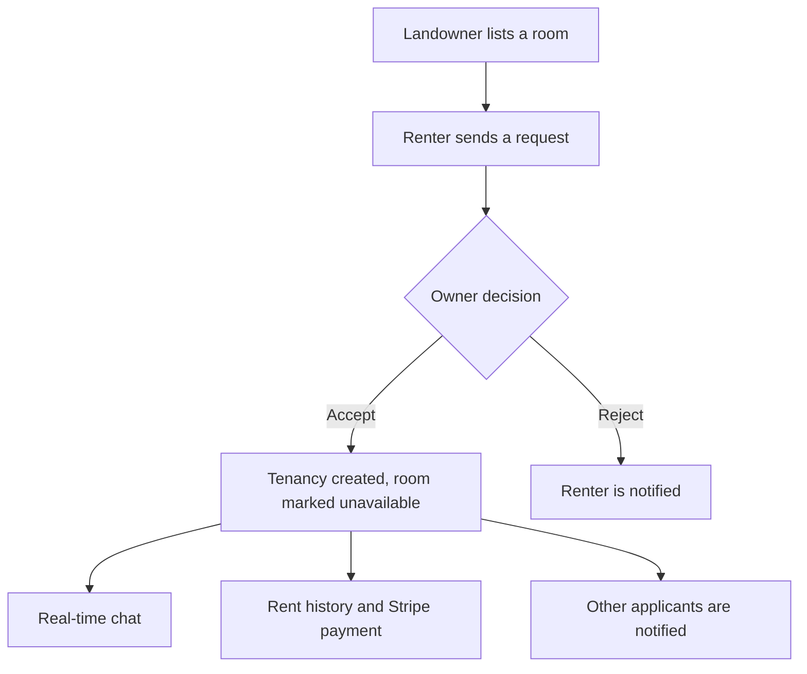
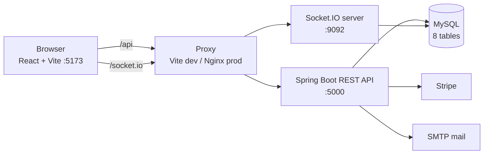

<div align="center">

# 🏠 EasyRent

### A full-stack room rental platform connecting landowners and renters

Browse rooms · Send requests · Chat in real time · Pay rent online

<br/>


<br/>

[Features](#-features) ·
[Architecture](#-architecture) ·
[Quick Start](#-quick-start) ·
[API](#-api-overview) ·
[Testing](#-testing-with-postman) ·
[Troubleshooting](#-troubleshooting) ·
[Author](#-author)

</div>

---

## 📖 About

EasyRent connects **landowners** and **renters**. Landowners list their rooms, renters browse and send requests, and owners accept or reject them. Once a request is accepted, both sides can chat in real time, track rent payments, and pay rent online.

The frontend is built with **React**. The backend is built with **Spring Boot + MySQL**. It was migrated from a Node.js / Express / MongoDB backend while keeping the same API contract, so the React app needed no changes.

---

## ✨ Features

<table>
<tr>
<td width="50%" valign="top">

### 🔐 Accounts and Security
- Register and log in as **renter**, **landowner** or **admin**
- JWT stored in an **HttpOnly cookie**
- Passwords hashed with **BCrypt**
- Forgot-password with a time-limited email link
- Role-based access on every protected route

</td>
<td width="50%" valign="top">

### 🏘️ Rooms
- Landowners create, edit, delete and toggle availability
- Renters browse with pagination and city/state search
- Save rooms to a favourites list
- Room details with owner information

</td>
</tr>
<tr>
<td width="50%" valign="top">

### 🤝 Rental Workflow
- Renters send or withdraw a request
- Owners review all requests for a room
- Accepting creates a tenancy and marks the room unavailable
- Other applicants are notified automatically
- Owners can archive or remove a tenant

</td>
<td width="50%" valign="top">

### 💳 Payments and History
- Rent history for every tenancy (cash or online)
- Online payment via **Stripe Checkout**
- Payment confirmed by a signed webhook
- Owner is notified when rent is paid

</td>
</tr>
<tr>
<td colspan="2" valign="top">

### ⚡ Real Time
- Live **chat** between owner and renter (Socket.IO), messages are saved to the database
- Live **notifications**: request received, accepted, rejected, rent paid

</td>
</tr>
</table>

---

## 🧭 Rental Flow



---

## 🏗️ Architecture



- The REST API and the Socket.IO server run on **two ports**. A proxy puts both behind one origin so cookies work without CORS problems.
- Authentication uses custom annotations (`@JwtAuth`, `@LandOwnerAuth`, `@AdminAuth`) checked by one `HandlerInterceptor`.
- Tables reference each other through plain id columns (no database foreign keys). Ids are 24-character hex strings, which keeps them compatible with the original frontend.

**Tables:** `users` · `rooms` · `requests` · `relationships` · `history` · `notifications` · `favourites` · `chats`

<details>
<summary><b>📁 Project structure</b></summary>

<br/>

```
Easy_Rent/
├── easyrent-springboot-mysql/
│   ├── backend-springboot/            Spring Boot application
│   │   ├── pom.xml
│   │   └── src/main/
│   │       ├── java/com/easyrent/backend/
│   │       │   ├── config/            CORS, security, Stripe
│   │       │   ├── controller/        REST controllers
│   │       │   ├── dto/               Request bodies
│   │       │   ├── entity/            JPA entities
│   │       │   ├── exception/         Global error handler
│   │       │   ├── repository/        Spring Data repositories
│   │       │   ├── security/          JWT, cookies, auth annotations
│   │       │   ├── service/           Notification service
│   │       │   ├── socket/            Socket.IO server and events
│   │       │   └── util/              Id generator, email service
│   │       └── resources/
│   │           ├── application.properties
│   │           └── schema.sql         Optional manual schema
│   └── frontend/                      React application (Vite)
├── EasyRent-FullFlow.postman_collection.json
└── README.md
```

</details>

---

## 🚀 Quick Start

### Prerequisites

| Tool | Version |
|---|---|
| Java | 17 |
| Maven | 3.8+ (or the one bundled with IntelliJ IDEA) |
| Node.js | 18 or newer |
| MySQL | 8 |

### 1️⃣ Create the database

```sql
CREATE DATABASE easyrent CHARACTER SET utf8mb4;
```

Tables are created automatically on first start. To create them manually, use `backend-springboot/src/main/resources/schema.sql`.

### 2️⃣ Configure the backend

Open `backend-springboot/src/main/resources/application.properties` and set your MySQL username and password.

> ⚠️ **Never commit real passwords or API keys.** Use environment variables or keep local changes out of Git.

### 3️⃣ Run the backend

```bash
cd easyrent-springboot-mysql/backend-springboot
mvn spring-boot:run
```

You can also open the folder in IntelliJ IDEA and run `EasyrentBackendApplication`.

On a good start you will see the REST API on **port 5000** and the Socket.IO server on **port 9092**.

### 4️⃣ Run the frontend

Create a file named `.env` inside the `frontend` folder:

```
VITE_API_URL=http://localhost:5173/api
```

Then start it:

```bash
cd easyrent-springboot-mysql/frontend
npm install
npm run dev
```

Open **http://localhost:5173** 🎉

> 💡 Vite reads `.env` only at startup. If you create or change it, stop the server and run `npm run dev` again.

---

## ⚙️ Configuration

<details>
<summary><b>Environment variables (click to expand)</b></summary>

<br/>

| Variable | Purpose | Default |
|---|---|---|
| `PORT` | REST API port | `5000` |
| `SOCKET_PORT` | Socket.IO port | `9092` |
| `DB_HOST` `DB_PORT` `DB_NAME` | MySQL connection | `localhost` `3306` `easyrent` |
| `SECRET_KEY` | JWT signing secret. **Change it for any real deployment.** | placeholder |
| `FRONTEND_URL` | Frontend origin for CORS, email links and Stripe redirects | `http://localhost:5173` |
| `PRODUCTION` | Set `true` behind HTTPS (Secure + SameSite=None cookies) | `false` |
| `MAIL_HOST` `MAIL_PORT` `MAIL_USERNAME` `MAIL_PASSWORD` `MAIL_FROM` | SMTP for welcome and reset emails | Gmail SMTP, empty login |
| `STRIPE_SECRET_KEY` `STRIPE_WEBHOOK_SECRET` | Stripe keys | empty |

Email and Stripe are optional for local development. Without SMTP credentials, emails fail quietly (logged only) and registration still works. Without Stripe keys, only online payment is unavailable.

</details>

---

## 🔌 API Overview

All endpoints are under `/api`. Protected endpoints read the JWT from the `token` cookie.

<details>
<summary><b>Show all endpoints</b></summary>

<br/>

| Module | Endpoints |
|---|---|
| **Users** `/api/users` | `POST /register` · `POST /login` · `POST /logout` · `PUT /editprofile` · `POST /password/forget` · `POST /password/reset/{token}` |
| **Rooms** `/api/rooms` | `POST /` · `GET /availableRoom` · `GET /myRoom` · `GET /roomDetails/{id}` · `PUT /{id}` · `DELETE /{id}` · `POST /toggle-room/{id}` |
| **Requests** `/api/request` | `POST /{roomId}` (send or withdraw) · `GET /{roomId}` · `GET /users/{roomId}` |
| **Relationships** `/api/relationship` | `POST /accept` · `POST /reject` · `GET /getRenters` · `GET /getRoomDetails` · `GET /historyOfRenter` · `GET /engaged` · `POST /removeRenter` · `DELETE /deleteRenter/{id}` |
| **History** `/api/history` | `POST /{relationId}` · `GET /{relationId}` · `PATCH /{historyId}` · `DELETE /{historyId}` |
| **Favourites** `/api/favourite` | `GET /toggle/{roomId}` · `GET /myfavourite` · `GET /isFabRoom/{roomId}` |
| **Notifications** `/api/notifications` | `GET /` · `GET /unread` · `PATCH /read-all` · `PATCH /{id}/read` |
| **Payments** `/api/payment` | `POST /create-checkout-session` · `GET /verify/{sessionId}` · `POST /webhook` · `GET /history/{userId}` |
| **Search** `/api/search` | `GET /district-state` |
| **Chat** `/api/chat` | `GET /{relationId}` |

**Socket.IO events:** `register` · `join_chat` · `send_message` · `receive_message` · `notification`

</details>

---

## 🧪 Testing with Postman

Import `EasyRent-FullFlow.postman_collection.json` and run it with the **Collection Runner**. It walks through the whole flow in order:

1. Register a renter and a landowner
2. Log in as the landowner and create a room
3. Log in as the renter and send a request
4. Log in as the landowner and accept it
5. Check notifications, tenancy details and rent history

IDs such as `roomId`, `renterId` and `relationId` are captured automatically between requests. Start the backend on port 5000 first.

---

## 🛠️ Troubleshooting

<details>
<summary><b>SocketIO server start failed at port 9092 (Address already in use)</b></summary>

<br/>

Another process, often an older copy of this backend, is using the port.

```
netstat -ano | findstr :9092
taskkill /PID <pid> /F
```

Or use another port: set `SOCKET_PORT=9093` and change the `/socket.io` target in `frontend/vite.config.js` to match.

</details>

<details>
<summary><b>Frontend calls <code>undefined/users/register</code> (404)</b></summary>

<br/>

`VITE_API_URL` was not loaded. Make sure `.env` is in the `frontend` folder (not `src`), then restart `npm run dev`.

</details>

<details>
<summary><b><code>vite</code> is not recognized</b></summary>

<br/>

Run `npm install` inside the `frontend` folder first.

</details>

<details>
<summary><b>Logged out in the browser even though login works in Postman</b></summary>

<br/>

Open the app through `http://localhost:5173` (the proxy origin), not directly through port 5000, so the auth cookie is sent correctly.

</details>

---

## ⚠️ Known Limitations

- The `admin` role exists, but admin-only endpoints currently always deny access (inherited from the original application).
- The login response includes the password hash (also inherited). Remove it before any real deployment.
- Relations between tables are not enforced by database foreign keys.
- The socket-to-user mapping lives in memory, so it works for a single server instance. Multiple instances would need a shared layer such as Redis.
- `ddl-auto=update` is for development. Use a migration tool such as Flyway in production.
- Automated tests are not included yet.

---

## 👨‍💻 Author

<div align="center">

### Shubham Malviya

MCA student at NIT Raipur

[](https://www.linkedin.com/in/shubham-malviya-a8b3b6321)
[](https://www.instagram.com/shubhamchouhan1001)

<br/>

⭐ If you like this project, please give it a star.

</div>
